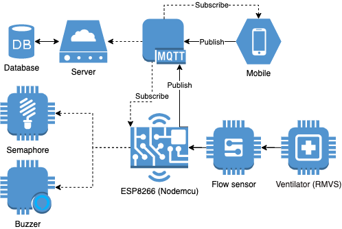

# COVID-19 Airflow Sensor

A proof of concept of a **Rapidly Manufactured Ventilation System (RMVS)** integrated with a flow sensor and an MQTT broker.

An ESP8266 board reads the oxygen flow from a sensor attached to the ventilation system and publishes it to an MQTT broker. The broker persists the readings in MongoDB, evaluates the flow rate, and publishes alerts back to the device — which reacts by lighting a semaphore (green/yellow/red LEDs) and sounding a buzzer when the flow is critical.



## How it works

1. The **IoT device** (ESP8266 + flow sensor) measures the flow rate every second and publishes a JSON payload (`{"rate": <L/min>, "total": <mL>, "time": <ms>}`) to the `sensor/flow` topic.
2. The **server** runs an [Aedes](https://github.com/moscajs/aedes) MQTT broker that persists every message to MongoDB and evaluates each flow reading:
   - rate < 5 L/min → publishes `RED` to `alert/semaphore`
   - rate < 18 L/min → publishes `YELLOW`
   - otherwise → publishes `GREEN`
3. The **IoT device** subscribes to the alert topics and turns on the matching LED. On `RED` it also plays the buzzer.
4. A background job (scheduled with [Bree](https://github.com/breejs/bree)) periodically analyzes the flow readings stored in the database.

### MQTT topics

| Topic             | Direction       | Payload                                    |
| ----------------- | --------------- | ------------------------------------------ |
| `sensor/flow`     | device → broker | `{"rate": 20, "total": 1500, "time": 123}` |
| `sensor/airflow`  | broker → any    | flow rate as plain text                    |
| `alert/semaphore` | broker → device | `RED`, `YELLOW` or `GREEN`                 |
| `alert/buzzer`    | any → device    | `ON` or `OFF`                              |

## Project structure

```
.
├── iot/      # ESP8266 firmware (Arduino sketch, built with arduino-cli)
└── server/   # Node.js MQTT broker + MongoDB persistence + scheduled jobs
```

## Quick start

Each part has its own README with detailed setup steps:

1. **[Server](./server/README.md)** — start MongoDB (Docker) and the MQTT broker first.
2. **[IoT](./iot/README.md)** — configure Wi-Fi/broker credentials, compile and upload the firmware to the ESP8266.

Once both are running, the device connects to the broker automatically and starts publishing flow readings. You can also interact with the device manually using any MQTT client (see the [server README](./server/README.md#manual-mqtt-calls)).

## License

[MIT licensed](./LICENSE).
