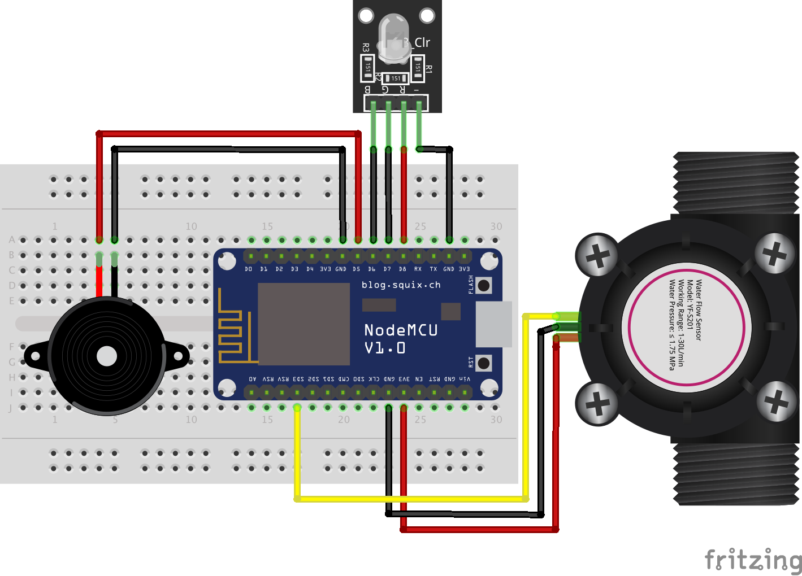

# IoT

ESP8266 (NodeMCU) firmware that reads a flow sensor every second, publishes the readings to the MQTT broker, and reacts to alerts by lighting a semaphore (red/yellow/green LEDs) and playing a buzzer.



## Hardware

- ESP8266 board (NodeMCU v2 — the Makefile uses the `esp8266:esp8266:nodemcuv2` FQBN)
- Flow sensor (e.g. YF-S201)
- 3 LEDs (red, yellow, green) + resistors
- Piezo buzzer

### Pinout

| Component   | Pin | GPIO   |
| ----------- | --- | ------ |
| Red LED     | D8  | GPIO15 |
| Yellow LED  | D7  | GPIO13 |
| Green LED   | D6  | GPIO12 |
| Buzzer      | D5  | GPIO14 |
| Flow sensor | SD3 | GPIO10 |

## Prerequisites

- [arduino-cli](https://arduino.github.io/arduino-cli/installation/)
- `make` (preinstalled on macOS/Linux)
- The [server](../server/README.md) running, so the device has a broker to connect to

## Setup

### 1. Install the ESP8266 core and libraries

```sh
make all
```

Verify the installation:

```sh
$ make core-list
ID              Installed Latest Name
esp8266:esp8266 2.7.1     2.7.1

$ make lib-list
Name              Installed Available Location
ArduinoJson       6.15.2    -         user
EspMQTTClient     1.8.0     -         user
...
```

### 2. Configure your credentials

Edit `secrets.h` with your Wi-Fi network and MQTT broker details (the broker is the machine running the [server](../server/README.md), port `1883`):

```c
#define WIFI_SSID "your-wifi-name"
#define WIFI_PASSWORD "your-wifi-password"
#define MQTT_SERVER_IP "192.168.0.10"   // IP of the machine running the server
#define MQTT_USERNAME ""
#define MQTT_PASSWORD ""
#define MQTT_CLIENT_NAME "RMVS_ESP8266"
#define MQTT_SERVER_PORT 1883
```

⚠️ Don't commit real credentials.

### 3. Compile the sketch

```sh
$ make compile
Global variables use 30476 bytes (37%) of dynamic memory, leaving 51444 bytes for local variables. Maximum is 81920 bytes.
```

This creates a build folder (e.g. `esp8266.esp8266.nodemcuv2/`) inside `iot/` containing the `.bin` firmware.

### 4. Upload the firmware

**Via USB:** check that your board is recognized:

```sh
$ make board-list
Port                            Type              Board Name FQBN Core
/dev/cu.usbserial-0001          Serial Port (USB) Unknown
```

If your port differs from the default (`/dev/cu.usbserial-0001`), either change the `PORT` variable in the `Makefile` or override it on the command line:

```sh
make upload PORT=/dev/cu.usbserial-XXXX
```

A successful upload ends with:

```
Hash of data verified.
Leaving...
Hard resetting via RTS pin...
```

**Over the air (OTA):** once the board has run the firmware at least once, it exposes a web updater at `http://rmvs_esp8266.local/` — open it in a browser and upload the `.bin` file from the build folder. The updater uses the MQTT username/password from `secrets.h` as login.

## Verify it's working

Open the serial monitor at **115200 baud** (e.g. `arduino-cli monitor -p /dev/cu.usbserial-0001 -c baudrate=115200`). You should see the Wi-Fi/MQTT connection debug messages followed by flow readings every second:

```
Flow rate: 20L/min	Output Liquid Quantity: 1500mL / 1L
```

On the server side, the broker logs the `sensor/flow` messages as they arrive. You can also trigger the LEDs and buzzer manually — see [Manual MQTT calls](../server/README.md#manual-mqtt-calls).

## Makefile reference

Run `make help` to see all commands:

| Command           | Description                                    |
| ----------------- | ---------------------------------------------- |
| `make all`        | Install the ESP8266 core and libraries         |
| `make board-list` | List connected boards                          |
| `make core-list`  | List installed platform cores                  |
| `make lib-list`   | List installed libraries                       |
| `make compile`    | Compile the sketch                             |
| `make upload`     | Upload the sketch (`PORT=...` to override)     |
